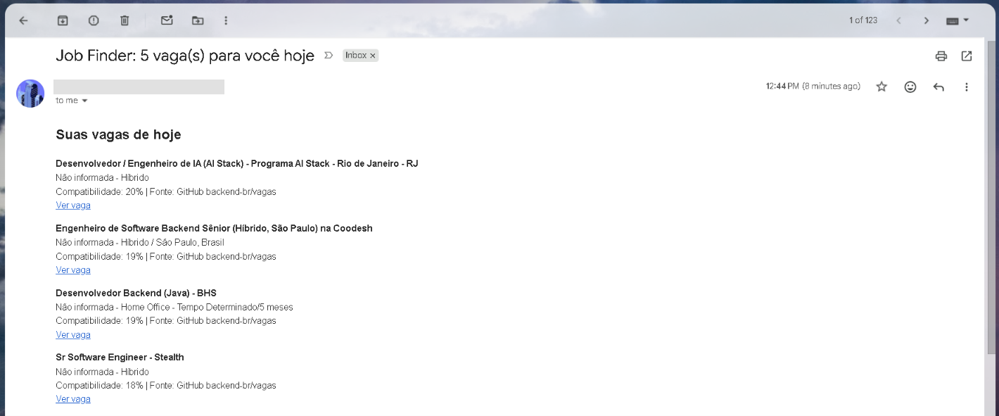
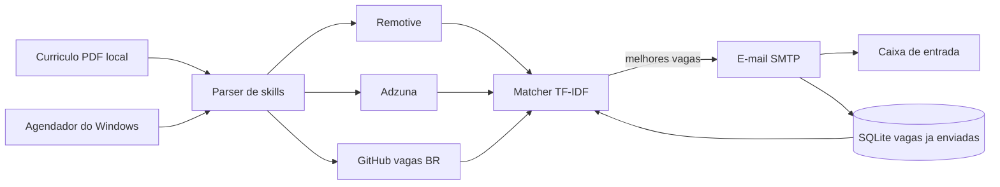

# Job Finder
 

 
Programa em Python que lê o seu currículo em PDF, busca vagas de emprego em fontes
oficiais, calcula uma nota de compatibilidade para cada vaga e envia por e-mail,
todo dia, só as melhores, sem repetir.
 

 
## O problema
 
Procurar vaga manualmente em vários sites é lento e repetitivo. Esta ferramenta faz
a busca por você e entrega o resultado na caixa de entrada, já ordenado por
compatibilidade com o seu perfil.
 
## Como ficou o projeto
 
- Lê o currículo em PDF e identifica as tecnologias que aparecem nele
- Busca vagas em três fontes, cada uma isolada das outras
- Dá uma nota de 0 a 1 para cada vaga (TF-IDF e similaridade do cosseno)
- Envia por e-mail até 5 vagas por execução, com nota e fonte de cada uma
- Guarda em um banco SQLite as vagas já enviadas, para nunca repetir
- Roda sozinho todo dia pelo Agendador de Tarefas do Windows
- Tem 10 testes automatizados, executados no GitHub Actions a cada push
### Exemplo de execução
 
```
INFO Skills encontradas: ['python', 'java', 'mysql', 'aws']
INFO Top scores: [0.22, 0.21, 0.2, 0.2, 0.19, 0.19, 0.18, 0.18, 0.17, 0.17]
INFO E-mail enviado com 5 vaga(s)
```
 
## Arquitetura
 

 
Estrutura de arquivos:
 
```
src/
  config.py       le as variaveis do .env
  cv_parser.py    extrai texto e skills do PDF
  jobs.py         busca vagas nas tres fontes
  matcher.py      calcula a nota de compatibilidade
  database.py     controle das vagas ja enviadas (SQLite)
  emailer.py      monta e envia o e-mail
  main.py         junta tudo (aceita --dry-run)
tests/            testes automatizados com pytest
run.bat           executa o programa e grava o log
```
 
## Fontes de vagas
 
- **Remotive:** API pública, vagas remotas do mundo todo
- **Adzuna:** API oficial com vagas no Brasil (opcional, exige chaves gratuitas)
- **Comunidades de vagas no GitHub:** `backend-br/vagas` e `frontendbr/vagas`,
  lidas pela API oficial do GitHub
Nenhuma fonte usa scraping. Se uma fonte falhar ou estiver sem chaves, as outras
continuam funcionando.
 
## Tecnologias
 
Python, pypdf, requests, scikit-learn, SQLite, smtplib, pytest, GitHub Actions.
 
## Como rodar
 
1. `git clone https://github.com/Koban07/job-finder-bot.git`
2. `cd job-finder-bot`
3. `python -m venv venv` e ative o ambiente (`venv\Scripts\activate` no PowerShell)
4. `pip install -r requirements.txt`
5. Crie uma **senha de app** na sua conta Google (exige verificação em duas etapas)
6. Copie `.env.example` para `.env` e preencha os dados
   (as chaves do Adzuna são opcionais)
7. Coloque seu currículo em `data/curriculo.pdf` (PDF com texto selecionável)
8. Teste sem enviar e-mail: `python -m src.main --dry-run`
9. Envie de verdade: `python -m src.main`
### Variáveis do `.env`
 
| Variável | Para que serve |
|---|---|
| `EMAIL_FROM` | conta Gmail que envia |
| `EMAIL_APP_PASSWORD` | senha de app do Google |
| `EMAIL_TO` | e-mail que recebe as vagas |
| `CV_PATH` | caminho do currículo (padrão `data/curriculo.pdf`) |
| `MIN_SCORE` | nota mínima de compatibilidade (padrão `0.10`) |
| `MAX_JOBS` | máximo de vagas por e-mail (padrão `5`) |
| `ADZUNA_APP_ID` e `ADZUNA_APP_KEY` | chaves do Adzuna (opcionais) |
 
## Agendamento (Windows)
 
O `run.bat` roda o programa com o Python do ambiente virtual e grava o resultado em
`logs/run.log`. Para executar todo dia às 9h, registre uma tarefa no PowerShell, na
pasta do projeto:
 
```powershell
$action = New-ScheduledTaskAction -Execute "$PWD\run.bat" -WorkingDirectory "$PWD"
$trigger = New-ScheduledTaskTrigger -Daily -At 9:00AM
$settings = New-ScheduledTaskSettingsSet -StartWhenAvailable
Register-ScheduledTask -TaskName "JobFinder" -Action $action -Trigger $trigger -Settings $settings
```
 
O `-StartWhenAvailable` faz a tarefa rodar assim que o computador ligar, caso ele
estivesse desligado no horário.
 
## Decisões técnicas
 
- **TF-IDF em vez de embeddings:** simples, rápido e sem GPU. Limitação: com
  currículo em português e vagas em inglês, a nota fica baixa. Incluir fontes em
  português melhorou bastante as notas. Próximo passo: embeddings multilíngues.
- **Fontes oficiais, sem scraping:** respeita os termos de uso e não quebra quando
  um site muda o layout.
- **Fontes isoladas:** cada uma é uma função que devolve o mesmo formato de vaga.
  Adicionar uma fonte nova não exige mexer no resto do programa.
- **SQLite** para lembrar quais vagas já foram enviadas. Uma vaga só é marcada como
  enviada depois que o e-mail sai, então uma falha de envio não faz perder vagas.
- **Senha de app** em vez da senha da conta: pode ser revogada a qualquer momento.
- **Modo `--dry-run`** para testar e ajustar a nota mínima sem enviar e-mail.
- **Logs sem segredos:** os avisos de falha de fonte não mostram a URL, porque ela
  pode conter chaves de API.
## Limitações
 
- O envio por SMTP depende de a rede liberar e-mail. Algumas redes de faculdade e de
  empresa bloqueiam. Nesse caso nada se perde: o programa tenta de novo na
  execução seguinte.
- As vagas do Adzuna vêm com descrição resumida, o que pode baixar a nota delas.
- O agendamento no Windows exige o computador ligado.
## Privacidade
 
O currículo fica só no seu computador (pasta `data/`, ignorada pelo Git, assim como
o `.env`, o banco de dados e os logs). Para as APIs são enviadas apenas
palavras-chave das suas skills, nunca o texto do currículo.
 
## Testes
 
```
python -m pytest
```
 
São 10 testes, que cobrem o leitor de currículo, o cálculo de nota, o banco de vagas
enviadas, a montagem do e-mail e as fontes de vagas (com respostas simuladas, sem
acessar a internet).
 
## Próximos passos
 
- Interface web com Streamlit
- Embeddings multilíngues para o matching
- Mais fontes de vagas (Jooble)
- Envio por HTTPS (API de e-mail) para funcionar em redes que bloqueiam SMTP
- Filtros por senioridade, país e tipo de contrato
Fontes das vagas: Remotive (remotive.com), Adzuna (adzuna.com.br) e as comunidades
backend-br/vagas e frontendbr/vagas no GitHub.
 